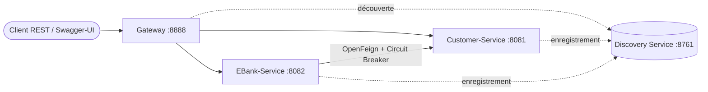

# 🏦 Architecture Microservices – Customer & E-Bank

Application basée sur une **architecture microservices** avec Spring Boot et Spring Cloud. Elle gère des clients (`Customer-Service`) et leurs comptes bancaires (`EBank-Service`), avec communication inter-services, tolérance aux pannes, passerelle d'accès et découverte de services.

---

## 📋 Table des matières

- [Objectifs](#-objectifs)
- [Architecture](#-architecture)
- [Technologies](#-technologies)
- [Structure du projet](#-structure-du-projet)
- [Les services](#-les-services)
- [Communication avec OpenFeign](#-communication-avec-openfeign)
- [Fault Tolerance avec Resilience4J](#-fault-tolerance-avec-resilience4j)
- [Lancer le projet](#-lancer-le-projet)
- [Tests avec Swagger-UI](#-tests-avec-swagger-ui)
- [Auteur](#-auteur)

---

## 🎯 Objectifs

- [x] Développer le service **Customer-Service**
- [x] Développer le service **EBank-Service**
- [x] Établir la communication entre les deux services avec **OpenFeign**
- [x] Mettre en place la **tolérance aux pannes** avec le Circuit Breaker **Resilience4J**
- [x] Développer la **Gateway** (Spring Cloud Gateway)
- [x] Développer le **Discovery Service** (Eureka Server)
- [x] Tester les services backend avec un client REST : **Swagger-UI**

---

## 🏗 Architecture



| Service            | Rôle                                         | Port   |
|--------------------|----------------------------------------------|--------|
| Discovery Service  | Registre des services (Eureka Server)        | `8761` |
| Gateway            | Point d'entrée unique, routage dynamique     | `8888` |
| Customer-Service   | Gestion des clients                          | `8081` |
| EBank-Service      | Gestion des comptes bancaires                | `8082` |

> ℹ️ Adaptez les ports selon votre configuration.

---

## 🛠 Technologies

- **Java 17+**
- **Spring Boot 3.x**
- **Spring Cloud** (Netflix Eureka, Gateway, OpenFeign)
- **Resilience4J** (Circuit Breaker)
- **Spring Data JPA** + base de données **H2** (ou MySQL)
- **Lombok**
- **springdoc-openapi** (Swagger-UI)
- **Maven**

---

## 📁 Structure du projet

```
.
├── discovery-service/     # Eureka Server
├── gateway-service/       # Spring Cloud Gateway
├── customer-service/      # Microservice clients
├── ebank-service/         # Microservice comptes bancaires
└── README.md
```

---

## 🧩 Les services

### 1. Discovery Service

Serveur Eureka permettant l'enregistrement et la découverte dynamique des microservices.

**Dépendance :** `spring-cloud-starter-netflix-eureka-server`

```java
@SpringBootApplication
@EnableEurekaServer
public class DiscoveryServiceApplication {
    public static void main(String[] args) {
        SpringApplication.run(DiscoveryServiceApplication.class, args);
    }
}
```

```properties
server.port=8761
eureka.client.register-with-eureka=false
eureka.client.fetch-registry=false
```

📍 Console Eureka : <http://localhost:8761>

---

### 2. Customer-Service

Gère le cycle de vie des clients (CRUD).

**Dépendances :** Spring Web, Spring Data JPA, H2, Lombok, Eureka Client, springdoc-openapi

| Méthode  | Endpoint           | Description               |
|----------|--------------------|---------------------------|
| `GET`    | `/customers`       | Lister tous les clients   |
| `GET`    | `/customers/{id}`  | Récupérer un client       |
| `POST`   | `/customers`       | Créer un client           |
| `PUT`    | `/customers/{id}`  | Modifier un client        |
| `DELETE` | `/customers/{id}`  | Supprimer un client       |

```properties
server.port=8081
spring.application.name=CUSTOMER-SERVICE
eureka.client.service-url.defaultZone=http://localhost:8761/eureka
```

---

### 3. EBank-Service

Gère les comptes bancaires et les associe à un client (récupéré depuis `Customer-Service`).

**Dépendances :** Spring Web, Spring Data JPA, H2, Lombok, Eureka Client, OpenFeign, Resilience4J, springdoc-openapi

| Méthode  | Endpoint                          | Description                          |
|----------|-----------------------------------|--------------------------------------|
| `GET`    | `/accounts`                       | Lister tous les comptes              |
| `GET`    | `/accounts/{id}`                  | Récupérer un compte (avec son client)|
| `POST`   | `/accounts`                       | Créer un compte                      |
| `GET`    | `/accounts/customer/{customerId}` | Comptes d'un client                  |

```properties
server.port=8082
spring.application.name=EBANK-SERVICE
eureka.client.service-url.defaultZone=http://localhost:8761/eureka
```

---

### 4. Gateway

Point d'entrée unique de l'application. Le routage est dynamique grâce à Eureka.

**Dépendances :** `spring-cloud-starter-gateway`, Eureka Client

```yaml
server:
  port: 8888

spring:
  application:
    name: GATEWAY-SERVICE
  cloud:
    gateway:
      discovery:
        locator:
          enabled: true
          lower-case-service-id: true

eureka:
  client:
    service-url:
      defaultZone: http://localhost:8761/eureka
```

Exemples d'accès via la gateway :

- `http://localhost:8888/customer-service/customers`
- `http://localhost:8888/ebank-service/accounts`

---

## 🔗 Communication avec OpenFeign

`EBank-Service` appelle `Customer-Service` de manière déclarative grâce à **OpenFeign**.

**Activation :**

```java
@SpringBootApplication
@EnableFeignClients
public class EbankServiceApplication { ... }
```

**Client Feign :**

```java
@FeignClient(name = "CUSTOMER-SERVICE")
public interface CustomerRestClient {

    @GetMapping("/customers/{id}")
    @CircuitBreaker(name = "customerService", fallbackMethod = "getDefaultCustomer")
    Customer findCustomerById(@PathVariable Long id);

    @GetMapping("/customers")
    @CircuitBreaker(name = "customerService", fallbackMethod = "getAllCustomers")
    List<Customer> allCustomers();

    default Customer getDefaultCustomer(Long id, Exception e) {
        Customer customer = new Customer();
        customer.setId(id);
        customer.setFirstName("Non disponible");
        customer.setLastName("Non disponible");
        customer.setEmail("Non disponible");
        return customer;
    }

    default List<Customer> getAllCustomers(Exception e) {
        return List.of();
    }
}
```

---

## 🛡 Fault Tolerance avec Resilience4J

Un **Circuit Breaker** protège `EBank-Service` en cas d'indisponibilité de `Customer-Service`. Si le service client est en panne ou trop lent, le circuit s'ouvre et une **méthode de repli (fallback)** est exécutée à la place de l'erreur.

**Dépendances :**

```xml
<dependency>
    <groupId>org.springframework.cloud</groupId>
    <artifactId>spring-cloud-starter-circuitbreaker-resilience4j</artifactId>
</dependency>
<dependency>
    <groupId>org.springframework.boot</groupId>
    <artifactId>spring-boot-starter-actuator</artifactId>
</dependency>
<dependency>
    <groupId>org.springframework.boot</groupId>
    <artifactId>spring-boot-starter-aop</artifactId>
</dependency>
```

**Configuration (`application.properties`) :**

```properties
resilience4j.circuitbreaker.instances.customerService.register-health-indicator=true
resilience4j.circuitbreaker.instances.customerService.sliding-window-size=10
resilience4j.circuitbreaker.instances.customerService.minimum-number-of-calls=5
resilience4j.circuitbreaker.instances.customerService.failure-rate-threshold=50
resilience4j.circuitbreaker.instances.customerService.wait-duration-in-open-state=10s
resilience4j.circuitbreaker.instances.customerService.permitted-number-of-calls-in-half-open-state=3
resilience4j.circuitbreaker.instances.customerService.automatic-transition-from-open-to-half-open-enabled=true

management.endpoints.web.exposure.include=*
management.health.circuitbreakers.enabled=true
```

**États du Circuit Breaker :**

| État          | Comportement                                                       |
|---------------|--------------------------------------------------------------------|
| `CLOSED`      | Les appels passent normalement                                     |
| `OPEN`        | Les appels sont bloqués, le fallback est exécuté                   |
| `HALF_OPEN`   | Quelques appels test pour vérifier si le service est rétabli       |

**Tester la résilience :**

1. Démarrer tous les services.
2. Appeler `GET /accounts/{id}` → les données du client s'affichent.
3. **Arrêter `Customer-Service`**.
4. Rappeler `GET /accounts/{id}` → la réponse de **fallback** est renvoyée.
5. Consulter l'état du circuit : <http://localhost:8082/actuator/health>

---

## 🚀 Lancer le projet

### Prérequis

- JDK 17+
- Maven 3.8+

### Ordre de démarrage

```bash
# 1. Cloner le dépôt
git clone https://github.com/<votre-username>/<nom-du-repo>.git
cd <nom-du-repo>

# 2. Discovery Service (en premier)
cd discovery-service && mvn spring-boot:run

# 3. Customer-Service
cd customer-service && mvn spring-boot:run

# 4. EBank-Service
cd ebank-service && mvn spring-boot:run

# 5. Gateway (en dernier)
cd gateway-service && mvn spring-boot:run
```

Vérifier que tous les services sont enregistrés sur <http://localhost:8761>.

---

## 🧪 Tests avec Swagger-UI

**Dépendance (dans Customer-Service et EBank-Service) :**

```xml
<dependency>
    <groupId>org.springdoc</groupId>
    <artifactId>springdoc-openapi-starter-webmvc-ui</artifactId>
    <version>2.5.0</version>
</dependency>
```

| Service           | Swagger-UI                                    |
|-------------------|-----------------------------------------------|
| Customer-Service  | <http://localhost:8081/swagger-ui.html>       |
| EBank-Service     | <http://localhost:8082/swagger-ui.html>       |

Swagger-UI permet de :

- visualiser tous les endpoints exposés,
- envoyer des requêtes `GET`, `POST`, `PUT`, `DELETE`,
- inspecter les réponses et les codes HTTP.

---

## 👤 Auteur

**Votre Nom**
- GitHub : [@votre-username](https://github.com/votre-username)
- LinkedIn : [Votre profil](https://linkedin.com/in/votre-profil)

---

⭐ N'hésitez pas à mettre une étoile au dépôt si ce projet vous a été utile !
